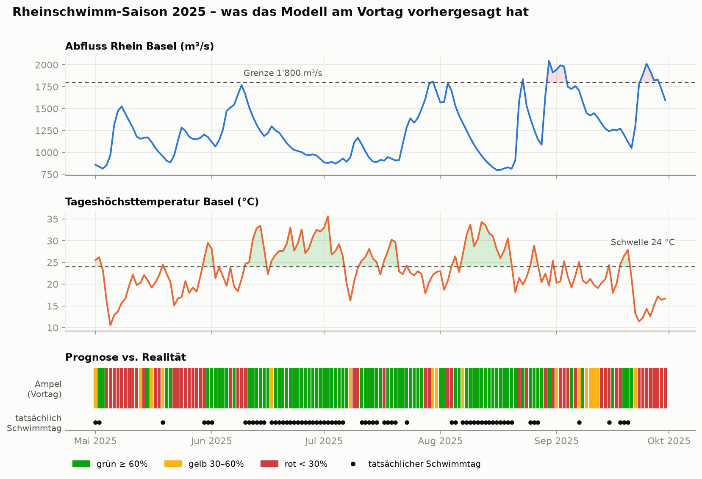
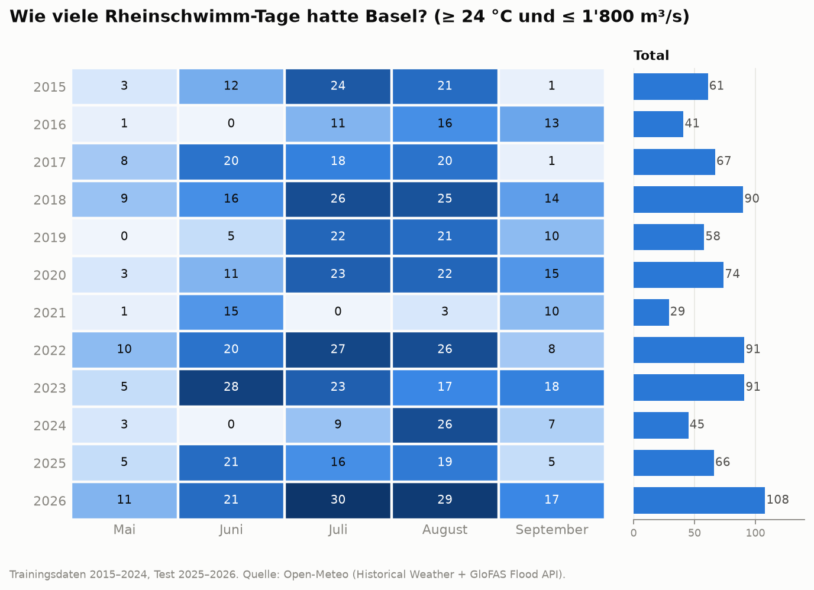
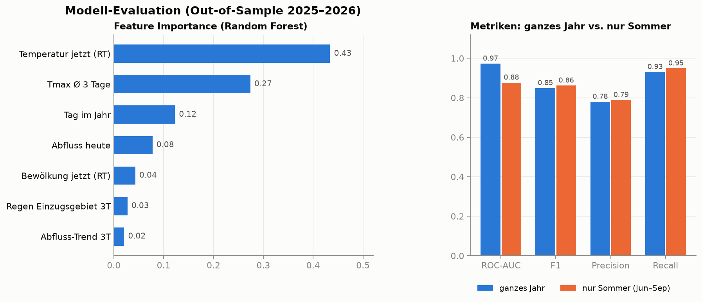

# 🏊 Rheinschwimm-Ampel Basel

**MLOps-Projektarbeit, CAS AI Operations 2026 (FHNW)**: FTI-Architektur (Feature / Training / Inference) mit dem Hopsworks Featurestore.

| | |
|---|---|
| **Autor** | Jonas Bretz <!-- ✏️ ggf. Teampartner/in ergänzen --> |
| **Repository** | [github.com/jonasb501/rheinschwimm-ampel-basel](https://github.com/jonasb501/rheinschwimm-ampel-basel) |
| **Hopsworks-Projekt** | `MLOps_project_CAS_2026` auf [eu-west.cloud.hopsworks.ai](https://eu-west.cloud.hopsworks.ai) |

Die Ampel beantwortet jeden Tag eine typische Basler Frage: **„Ist morgen ein guter Tag zum Rheinschwimmen?“**

```
==============================================================
  RHEINSCHWIMM-AMPEL BASEL  –  Prognose für 2025-06-15
  (Modell v1, Features vom 2025-06-14, RT 2025-06-14 12:00)
==============================================================
  Abfluss Rhein heute:               1244 m³/s
  Abfluss-Trend 3 Tage:              -273 m³/s
  ...
  Temperatur jetzt (RT):             31.4 °C
--------------------------------------------------------------
  Wahrscheinlichkeit Schwimmtag:      97%
  🟢 GRÜN  – ab in den Rhein!
  Tatsächlich:                   Schwimmtag ✅
==============================================================
```

---

## Inhalt
1. [Daten](#1-daten)
2. [Target (Label)](#2-target-label)
3. [Features](#3-features)
4. [Modell](#4-modell)
5. [Aufbau der Pipelines (FTI)](#5-aufbau-der-pipelines-fti)
6. [Setup und Ausführung](#6-setup-und-ausführung)
7. [Backtests für Sommertage](#7-backtests-für-sommertage)
8. [Evaluation und Visualisierungen](#8-evaluation-und-visualisierungen)
9. [Umgesetzte Ausbaustufen / Extras](#9-umgesetzte-ausbaustufen--extras)
10. [Stand der Umsetzung und Schwierigkeiten](#10-stand-der-umsetzung-und-schwierigkeiten)
11. [Limitationen und Reflexion](#11-limitationen-und-reflexion)

---

## 1. Daten

Alle Daten kommen von [Open-Meteo](https://open-meteo.com/) (kostenlos, **kein API-Key nötig**).

| API | Daten | Orte |
|---|---|---|
| [Flood API](https://open-meteo.com/en/docs/flood-api) | Täglicher Abfluss des Rheins in m³/s (GloFAS-Modell) | Rhein bei Basel |
| [Historical Weather API](https://open-meteo.com/en/docs/historical-weather-api) | Täglicher Niederschlag und Tmax, stündliche Temperatur und Bewölkung | Basel, Bern (Aare), Luzern (Reuss), Chur (Alpenrhein) |
| [Forecast API](https://open-meteo.com/en/docs) | Aktuelle Temperatur und Bewölkung (`current=`) | Basel |

**Historische vs. aktuelle Daten:**
- **Training:** 2015–2024 (ca. 3'650 Tage)
- **Test / Backtests:** ab 01.01.2025 bis heute (Out-of-Sample, das Modell hat diese Tage nie gesehen)
- **Live-Inferenz:** neueste Tageswerte aus dem Feature Store + aktuelle Werte der Forecast API

## 2. Target (Label)

`label_swim_tomorrow = 1`, wenn **morgen** beide Bedingungen erfüllt sind:
- Tageshöchsttemperatur in Basel **≥ 24 °C**
- Abfluss des Rheins bei Basel **≤ 1'800 m³/s**

Sonst ist das Label `0`. Es wird in der Feature-Pipeline mit `shift(-1)` aus den Werten des Folgetages berechnet. Für den neuesten Tag ist „morgen“ noch unbekannt, deshalb ist das Label dort `NULL` und wird beim Training ignoriert.
Verteilung 2015–2026: ca. **20% Schwimmtage**, fast ausschliesslich zwischen Juni und September.

## 3. Features

| Feature | Art | Beschreibung |
|---|---|---|
| `precip_catchment_3d_mm` | **aggregiert** (4 Orte × 3 Tage) | Mittlerer Niederschlag im Einzugsgebiet (Basel, Bern, Luzern, Chur), summiert über die letzten 3 Tage. Regen in den Alpen kommt verzögert in Basel an. |
| `discharge_trend_3d_m3s` | **aggregiert** (3 Tage) | Veränderung des Abflusses gegenüber vor 3 Tagen: Steigt oder sinkt der Rhein? |
| `tmax_basel_3d_mean_c` | **aggregiert** (3 Tage) | Mittlere Tageshöchsttemperatur in Basel über die letzten 3 Tage |
| `discharge_m3s` | Batch | Abfluss des Rheins heute |
| `day_of_year` | Batch | Saisonalität |
| `temp_now_c` | **RT** | Aktuelle Temperatur in Basel, erst zum Zeitpunkt der Inferenz bekannt |
| `cloud_cover_now_pct` | **RT** | Aktuelle Bewölkung in Basel, erst zum Zeitpunkt der Inferenz bekannt |

**So werden die RT-Features behandelt:**
- **Training:** Als „jetzt“ gilt der Wert um **12:00 Uhr** (stündliche Historical API). Diese historischen Werte liegen in der Feature Group, sonst wäre kein Training möglich.
- **Live-Inferenz:** Die gespeicherten Werte werden **durch Live-Werte der Forecast API ersetzt**.
- **Backtest (`--date`):** Der Wert von 12:00 Uhr an diesem Tag wird aus der Historical API geholt.

## 4. Modell

- **Algorithmus:** `RandomForestClassifier` (scikit-learn, 200 Bäume, `max_depth=8`, `class_weight="balanced"` wegen der nur ~20% positiven Tage)
- **Split:** zeitbasiert über die Event Time direkt im Hopsworks Training Dataset (`FeatureView.train_test_split`): Training 2015–2024, Test ab 2025. Ein zufälliger Split wäre bei Zeitreihen zu optimistisch.
- **Ampel:** aus der vorhergesagten Wahrscheinlichkeit: 🟢 ≥ 60%, 🟡 30–60%, 🔴 < 30%
- **Ergebnis** (siehe auch [Kapitel 8](#8-evaluation-und-visualisierungen) mit der Sommer-Evaluation; Hopsworks-Lauf vom 15.11.2026, Training 3'652 Tage, Test 683 Tage ab 2025): **ROC-AUC 0.973, F1 0.849, Accuracy 0.915**. Laut Aufgabenstellung ist die Performance nicht relevant.
  Confusion Matrix Test: 462 korrekt „kein Schwimmtag“, 163 korrekt „Schwimmtag“, 46 Fehlalarme, 12 verpasste Schwimmtage.
- **Feature Importance:** `temp_now_c` 0.43 · `tmax_basel_3d_mean_c` 0.27 · `day_of_year` 0.12 · `discharge_m3s` 0.08 · `cloud_cover_now_pct` 0.04 · `precip_catchment_3d_mm` 0.03 · `discharge_trend_3d_m3s` 0.02
- **In der Model Registry:** zusammen mit den Metriken, einem Input Example, der Verknüpfung zur Feature View (Lineage), `features.json`, `feature_importance.json` und `label_definition.json`

## 5. Aufbau der Pipelines (FTI)

```
            Open-Meteo: Flood API + Historical Weather API (4 Orte)
                                  │
                    ┌─────────────▼─────────────┐
                    │  1. feature_pipeline.py   │  Rohdaten → Rolling Windows /
                    │                           │  Aggregation → Label → Validierung
                    └─────────────┬─────────────┘
                                  │ insert
                ┌─────────────────▼──────────────────┐
                │ Feature Group  rhine_basel_daily v1│  PK: date_id
                │                                    │  Event Time: date
                └─────────────────┬──────────────────┘
                                  │
                ┌─────────────────▼──────────────────┐
                │ Feature View rheinschwimm_ampel_fv │  Features + Label
                └───────┬──────────────────────┬─────┘
                        ▼                      ▼
     ┌──────────────────────────┐   ┌──────────────────────────┐
     │ 2. training_pipeline.py  │   │ 3. inference_pipeline.py │ ◄── Forecast API
     │ train_test_split (Zeit)  │   │ get_batch_data (neueste) │     (RT-Features)
     │ RandomForest → Metriken  │   │ + RT → Prediction → Ampel│
     └────────────┬─────────────┘   └───────▲──────────┬───────┘
                  │ create_model + save     │ download │ insert (Log)
                  ▼                         │          ▼
          Hopsworks Model Registry ─────────┘   Feature Group
          (rheinschwimm_ampel)                  rheinschwimm_predictions v1
```

| Pipeline | Datei | Schritte |
|---|---|---|
| **1. Feature** | `feature_pipeline.py` | ① Rohdaten über die API abrufen (`ampel/openmeteo.py`) → ② Features engineeren: Rolling Windows, Aggregation über 4 Orte (`ampel/features.py`) → ③ Dataframe mit Features und Label erstellen → Datenvalidierung → ④ `get_or_create_feature_group` mit Primary Key `date_id` und Event Time `date` → ⑤ `insert` |
| **2. Training** | `training_pipeline.py` | ① Feature Group laden → ② Feature View mit Query `fg.select(Features + Label)` und `labels=[...]` erstellen → ③ Training Dataset mit `train_test_split` (Zeitgrenzen) → ④ trainieren und evaluieren (Report, Confusion Matrix, Feature Importance) → ⑤ `joblib.dump`, dann `mr.python.create_model(...).save()` |
| **3. Inferenz** | `inference_pipeline.py` | ① Feature View holen, mit `get_batch_data` die **neuesten** Features laden (bzw. die des Backtest-Tages) → ② Live-Daten (RT-Features) von der Forecast API abrufen → ③ bestes Modell (`roc_auc`) aus der Registry herunterladen → ④ Prediction und Ampel → ⑤ (Extra) Prediction in die Feature Group `rheinschwimm_predictions` loggen |

```
rheinschwimm-ampel-basel/
├── ampel/
│   ├── config.py               # Orte, Schwellen, Feature-Liste, Hopsworks-Namen
│   ├── openmeteo.py            # API-Clients (Flood, Archive, Forecast) mit Retry
│   └── features.py             # Feature Engineering + Label
├── feature_pipeline.py         # 1. Feature Pipeline
├── training_pipeline.py        # 2. Training Pipeline
├── inference_pipeline.py       # 3. Inference Pipeline
├── evaluation_plots.py         # Evaluation + Plots (liest aus Feature Store & Registry)
├── docs/                       # erzeugte Plots + metrics.json
├── .github/workflows/daily-ampel.yml   # tägliche Ausführung (Extra)
├── pyproject.toml / uv.lock    # Dependencies (uv)
├── requirements.txt            # dieselben Dependencies für pip
├── .python-version             # 3.12
└── .env.example                # Vorlage für den Hopsworks API-Key
```

## 6. Setup und Ausführung

### Voraussetzungen
- **Python 3.12** (Hopsworks verlangt Python < 3.14, festgelegt in `.python-version` und `pyproject.toml`)
- [uv](https://docs.astral.sh/uv/getting-started/installation/), alternativ pip
- Kostenloser Account auf [hopsworks.ai](https://www.hopsworks.ai/) mit einem Projekt und einem API-Key (Hopsworks UI → Account Settings → API Keys → *New API Key*, Scopes: alle)

Getestet auf macOS mit dem Client `hopsworks` 5.2.3. Es funktioniert auch in GitHub Codespaces, dort zuerst `pip install uv` ausführen.

### Installation
```bash
git clone https://github.com/jonasb501/rheinschwimm-ampel-basel.git
cd rheinschwimm-ampel-basel

uv sync                                  # erstellt .venv mit Python 3.12 und allen Paketen aus uv.lock
# Alternative ohne uv:
# python3.12 -m venv .venv && source .venv/bin/activate && pip install -r requirements.txt

cp .env.example .env                     # dann HOPSWORKS_API_KEY (und optional HOPSWORKS_PROJECT) eintragen
```

### Ausführen (Reihenfolge einhalten)
```bash
# 1. Feature Pipeline: Backfill 2015 bis heute (~4'300 Tage, dauert einige Minuten wegen Hopsworks-Job)
uv run python feature_pipeline.py

# 2. Training Pipeline: Feature View + Training Dataset + Modell in die Registry
uv run python training_pipeline.py

# 3. Inference Pipeline: Ampel für morgen (neueste Features + Live-RT-Werte)
uv run python inference_pipeline.py

# Optional: Evaluation und Plots neu erzeugen (docs/)
uv run python evaluation_plots.py
```

**Täglicher Betrieb:** Mit `uv run python feature_pipeline.py --start <Datum vor ein paar Tagen>` werden nur neue Tage geladen (Upsert über `date_id`). Danach `inference_pipeline.py` ausführen. Diesen Ablauf automatisiert der GitHub-Actions-Workflow (siehe [Extras](#9-umgesetzte-ausbaustufen--extras)).

## 7. Backtests für Sommertage

Mit `--date` lässt sich die Ampel für jeden vergangenen Tag rechnen und mit der Realität vergleichen. Die folgenden Tage stammen alle aus dem **Testzeitraum 2025**, das Modell hat sie beim Training nicht gesehen. Die Werte stammen aus dem Hopsworks-Lauf mit Modell v1.

| Befehl | Situation | Wahrscheinlichkeit / Ampel | Realität |
|---|---|---|---|
| `uv run python inference_pipeline.py --date 2025-06-14` | Hitzewelle, ruhiger Rhein (1'244 m³/s, 31 °C) | 97% 🟢 | Schwimmtag ✅ |
| `uv run python inference_pipeline.py --date 2025-07-10` | warm, aber unbeständig (22 °C) | 60% 🟢 (knapp) | Schwimmtag ✅ |
| `uv run python inference_pipeline.py --date 2025-07-29` | Rhein knapp unter der Grenze (1'781 m³/s), 19 °C | 32% 🟡 | kein Schwimmtag ❌ |
| `uv run python inference_pipeline.py --date 2025-08-30` | Rhein hoch (2'045 m³/s), obwohl es morgen 25 °C wird | 24% 🔴 | kein Schwimmtag ❌ |
| `uv run python inference_pipeline.py --date 2025-06-01` | **bekannter Fehler:** 26 °C, aber Wetterumschwung am Folgetag | 93% 🟢 | kein Schwimmtag ❌ |

Bei einem erneuten Training können die Wahrscheinlichkeiten um 1–2 Prozentpunkte abweichen.

## 8. Evaluation und Visualisierungen

`evaluation_plots.py` liest alle Features aus der Feature Group, lädt das Modell aus der Model Registry und erzeugt die folgenden Plots sowie [`docs/metrics.json`](docs/metrics.json). Damit folgt auch die Auswertung der FTI-Architektur: Sie verwendet ausschliesslich Daten aus dem Feature Store und das registrierte Modell.

```bash
uv run python evaluation_plots.py
```

### Die Saison 2025 im Rückblick



Die oberen zwei Panels zeigen die beiden Bedingungen des Labels (Abfluss und Tageshöchsttemperatur), das untere Panel die Ampel, die das Modell jeweils **am Vortag** gezeigt hat, und darunter die tatsächlichen Schwimmtage.
- **Juni/Juli und August 2025:** Die langen grünen Phasen decken sich gut mit den Hitzeperioden.
- **Ende August / Ende September:** Der Rhein steigt über 1'800 m³/s (rot schraffiert). Das Modell zeigt dort überwiegend Rot, obwohl es teilweise noch warm ist.
- **Typische Fehler:** Grüne Tage ohne Punkt sind Fehlalarme. Sie entstehen vor allem an Tagen mit einem Temperatursturz am Folgetag, z.B. Anfang Juni und in der zweiten Julihälfte.

### Wie viele Rheinschwimm-Tage gab es pro Jahr?



- **2021** hatte nur **29** Schwimmtage: Im Juli 2021 führte der Rhein nach tagelangem Starkregen Hochwasser, deshalb gibt es im Juli 0 Tage.
- **2024** hatte ebenfalls wenige (45): Beim Juni-Hochwasser stieg der Rhein auf bis zu ~2'400 m³/s, deshalb gibt es im Juni 0 Tage.
- **2026** ist mit **108** Tagen das beste Jahr der Datenreihe, gefolgt von 2018, 2022 und 2023 mit je ~90 Tagen.
- Die Heatmap zeigt auch, warum das Modell `day_of_year` nutzt: Fast alle Schwimmtage liegen zwischen Juni und August.

### Modell-Evaluation: ganzes Jahr vs. nur Sommer



| Test 2025–2026 | Tage | Schwimmtage | ROC-AUC | F1 | Precision | Recall |
|---|---|---|---|---|---|---|
| ganzes Jahr | 683 | 175 | **0.973** | 0.849 | 0.780 | 0.931 |
| nur Sommer (Jun–Sep) | 244 | 158 | **0.877** | 0.862 | 0.789 | 0.949 |

Die Erkenntnis: Die sehr hohe ROC-AUC über das ganze Jahr kommt zu einem guten Teil von den **einfachen Wintertagen**, an denen jede Vorhersage sicher Rot ist. Betrachtet man nur die Sommertage, an denen die Ampel tatsächlich gebraucht wird, sinkt die AUC auf **0.88**. Das Modell trennt also im Sommer deutlich schlechter. F1 und Recall bleiben ähnlich, weil im Sommer fast zwei Drittel der Tage Schwimmtage sind. Zudem zeigt die Feature Importance, dass die Rhein-Features (Abfluss, Regen im Einzugsgebiet, Trend) zusammen nur ~13% beitragen.

## 9. Umgesetzte Ausbaustufen / Extras

| Extra | Umsetzung |
|---|---|
| Datensplit im Hopsworks Training Dataset | `fv.train_test_split(train_start, train_end, test_start, test_end)`, zeitbasiert statt `sklearn.train_test_split` |
| Zurückspielen der RT-Features in den Feature Store | Jeder Inferenz-Lauf schreibt Features, RT-Werte, Wahrscheinlichkeit, Ampel und Modellversion in die Feature Group `rheinschwimm_predictions` (abschaltbar mit `--no-log`). Das ist die Basis für Monitoring und den späteren Vergleich mit der Ground Truth. |
| Datenvalidierung | Einfache Regeln vor dem Insert (`validate()` in `feature_pipeline.py`): eindeutiger Primary Key, keine fehlenden Features, plausible Wertebereiche. Eine leichtgewichtige Alternative zu Great Expectations. |
| Backtesting | `inference_pipeline.py --date YYYY-MM-DD` inkl. Vergleich mit dem tatsächlichen Label |
| Scheduling | `.github/workflows/daily-ampel.yml`: Feature- und Inference-Pipeline laufen täglich um 10:00 UTC, Retraining manuell per *Run workflow*. Dafür das Repository Secret `HOPSWORKS_API_KEY` und optional die Variable `HOPSWORKS_PROJECT` setzen. |
| Evaluation und Visualisierung | `evaluation_plots.py`: Saison-Rückblick, Heatmap der Schwimmtage 2015–2026, Feature Importance und eine separate Evaluation nur auf Sommertagen (siehe [Kapitel 8](#8-evaluation-und-visualisierungen)) |
| Robustheit | Retry mit Backoff bei Timeouts der Open-Meteo-API |

## 10. Stand der Umsetzung und Schwierigkeiten

Stand 15.11.2026: Alle drei Pipelines laufen vollständig gegen Hopsworks Serverless (`eu-west.cloud.hopsworks.ai`, Client 5.2.3).

| Pipeline | Status |
|---|---|
| Feature Pipeline | ✅ läuft: 4'337 Tage (2015-01-01 bis 2026-11-15) in `rhine_basel_daily` v1 |
| Training Pipeline | ✅ läuft: Feature View, Training Dataset (Zeit-Split), Modell `rheinschwimm_ampel` v1 in der Registry |
| Inference Pipeline (live + `--date`) | ✅ läuft: live und alle 5 Backtest-Tage aus Kapitel 7, Log in `rheinschwimm_predictions` v1 |
| Evaluation (`evaluation_plots.py`) | ✅ läuft: 3 Plots + `docs/metrics.json` aus Feature Store und Registry |
| GitHub Actions (optional) | ⚪ vorbereitet, benötigt das Repository Secret `HOPSWORKS_API_KEY` |

**Aufgetretene Schwierigkeiten und Lösungen:**
- **Timeouts der Open-Meteo API:** Die Archive API bricht bei grossen Abfragen (11 Jahre × 4 Orte) gelegentlich ab. Gelöst mit Retry und Backoff in `ampel/openmeteo.py`.
- **HTTP 500 beim Erstellen des Training Datasets:** `train_test_split(..., test_end="2100-01-01")` führte serverseitig zu „Transaction marked for rollback“. Mit einem realistischen Enddatum (morgen) funktioniert es.
- **Spaltennamen in `get_batch_data`:** Mit `primary_key=True` liefert Hopsworks den Primary Key mit Präfix (`<projekt>_<featuregroup>_<version>_date_id`). Die Inferenz sucht die Spalte deshalb über das Suffix `date_id`.
- **API-Key finden:** Der Key wird nicht im Projekt, sondern unter *Account settings → API* erstellt. Der Client verbindet sich standardmässig mit `eu-west.cloud.hopsworks.ai`.

## 11. Limitationen und Reflexion

- **Der Abfluss ist modelliert, nicht gemessen:** Die Flood API liefert Werte aus dem GloFAS-Modell (Raster ca. 5 km, tägliche Auflösung). Sie weichen von den Messwerten des BAFU (Station Rheinhalle Basel) ab. Für einen produktiven Einsatz müssten die BAFU-Hydrodaten verwendet werden.
- **Die Schwellen sind selbst gewählt:** 24 °C und 1'800 m³/s sind plausible Annahmen, aber **keine offizielle Empfehlung** (z.B. der SLRG oder des Kantons Basel-Stadt). Die Ampel ist kein Sicherheitsinstrument.
- **Es gibt keine Wassertemperatur:** Open-Meteo bietet sie nicht an, deshalb dient die Lufttemperatur als Ersatz. Im Frühsommer ist der Rhein bei warmer Luft oft noch kalt.
- **Das Modell ist im Kern eine Wettervorhersage:** Die Feature Importance zeigt, dass Temperatur und Saison dominieren. Die Rhein-Features (Abfluss, Regen im Einzugsgebiet) tragen nur wenig bei, weil der Abfluss im Sommer selten über 1'800 m³/s steigt. Wetterumschwünge erkennt das Modell nicht, z.B. den Fehlalarm am 01.06.2025. Als Verbesserung könnte die Open-Meteo-Prognose für morgen ein zusätzliches Feature werden.
- **Training/Serving Skew bei den RT-Features:** Im Training gilt 12:00 Uhr als „jetzt“. Läuft die Inferenz z.B. um 08:00, ist `temp_now_c` systematisch tiefer, und weil das das wichtigste Feature ist, wird die Ampel dann zu pessimistisch. Deshalb läuft der GitHub-Actions-Workflow um ca. 11–12 Uhr Lokalzeit.
- **Historische RT-Werte liegen in derselben Feature Group:** Sie sind nötig, damit trainiert werden kann. Sauberer wäre, nur echte Live-Werte zu sammeln (siehe `rheinschwimm_predictions`) und künftig darauf zu trainieren.
- **Saisonalität:** Von Oktober bis Mai ist die Ampel praktisch immer 🔴. Die Evaluation in Kapitel 8 belegt den Effekt: Über das ganze Jahr liegt die ROC-AUC bei 0.97, nur auf den Sommertagen (Jun–Sep) bei 0.88. Für eine ehrliche Beurteilung zählt deshalb die Sommer-Metrik.
- **Kein Monitoring / Drift Detection:** Die Predictions werden zwar geloggt, aber noch nicht automatisch mit der Ground Truth verglichen.
- **Hopsworks-Version:** Getestet wurde der Client `hopsworks` 5.2.3. Meldet `hopsworks.login()` eine Versionsabweichung zum Server, die Version in `pyproject.toml` auf die Server-Version pinnen und `uv sync` erneut ausführen.
